# softrender

[](https://github.com/salvadorurena/softrender/actions/workflows/ci.yml)

A multithreaded software rasterizer written from scratch in C++20. It uses no GPU and no graphics API: every pixel below comes from my own triangle pipeline running on the CPU.

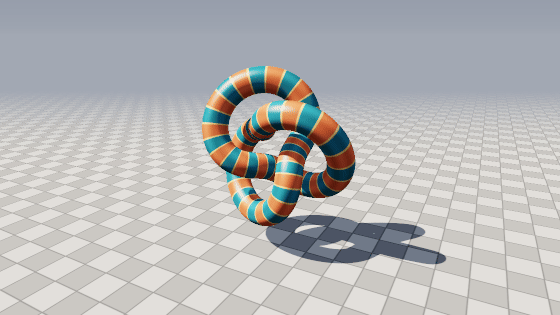

The core library has **no third-party dependencies**. It includes its own math, OBJ loader, texture sampler and PNG encoder. SDL3 is used only by the optional interactive viewer, to put the finished framebuffer in a window.

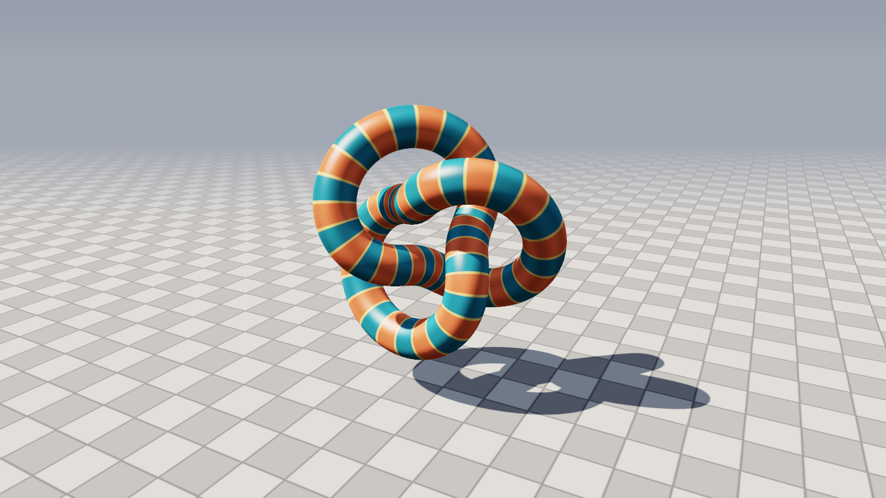

## Features

- **Programmable pipeline.** Vertex and fragment shaders are plain C++ structs passed as template parameters, so each shader gets its own fully inlined copy of the pipeline.
- **Exact fixed-point rasterization.** Edge functions run on 8-bit subpixel integer coordinates and use the **top-left fill rule**. Meshes are watertight: no cracks or double-shaded pixels on shared edges, and a test checks this.
- **Homogeneous clipping** against the near and far planes, plus a guard band in x/y. It uses Sutherland-Hodgman clipping and only clips against the planes a triangle actually crosses, chosen by outcodes.
- **Perspective-correct interpolation** of all varyings, plus backface culling and an early depth test.
- **GPU-style 2×2 pixel quads.** Pixels are shaded in groups of four, and lanes outside the triangle are still interpolated as "helper" lanes. Neighboring lanes give every fragment exact screen-space derivatives (`ddx`/`ddy`) of its inputs, the same mechanism behind GLSL's `dFdx` and `fwidth`.
- **Mipmapping with trilinear and 8× anisotropic filtering.** Each texture has a full mip chain, and the derivatives decide which level to read. Anisotropic filtering picks the level from the short axis of the pixel's footprint and takes up to 8 trilinear taps along the long axis, so surfaces seen at grazing angles stay sharp without shimmering.
- **Binned, multithreaded rasterization.** Vertex shading and triangle setup are split across all cores. During setup, each triangle is binned into the 8-row screen bands it touches. Raster threads then claim bands one at a time from an atomic counter, so a band full of dense or expensive geometry doesn't hold up the rest. Each band is owned by one thread and processes triangles in submission order, so pixels need no locks and every frame is deterministic.
- **8×8 tile classification.** Before any per-pixel work, each tile in a triangle's bounding box is tested against the three edge functions at its extreme corners. Tiles fully outside are skipped, and tiles fully inside skip per-pixel coverage tests. About half of all bounding-box tiles in the default scene are skipped this way.
- **Shadow mapping.** An orthographic depth pass from the sun with front-face culling, a slope-scaled bias and 16-tap PCF for soft edges.
- **Shading.** Blinn-Phong lighting with hemispheric ambient, ACES tone mapping, distance fog, and a sky gradient computed from each view ray's elevation.
- **Correct color handling.** Lighting runs in linear space, output is sRGB-encoded through a lookup table, and supersampling (`--ssaa N`) averages in linear space. Debug shaders declare `kOutputsDisplay` and are stored as-is, with no encode/decode round trip.
- **Debug views** for normals, depth, UVs (with constant-width anti-aliased grid lines drawn using derivatives) and mip levels, plus a depth-tested wireframe overlay.
- **OBJ loader** that handles polygons, negative indices, all `v/vt/vn` face forms and vertex deduplication. It generates smooth normals when the file has none.

| Normals | Depth | UVs |
|:-:|:-:|:-:|
| 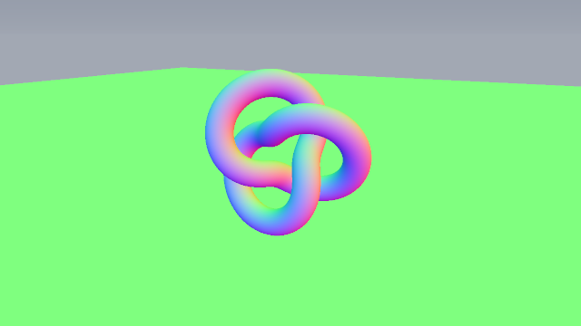 | 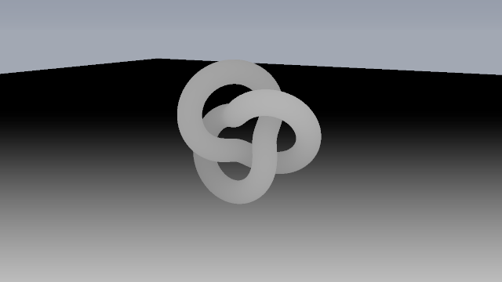 | 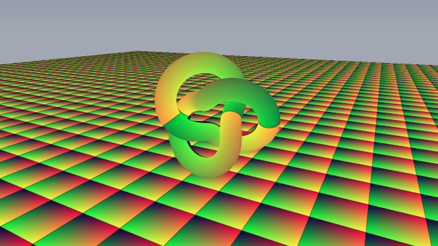 |
| **Wireframe overlay** | **Shadows off** | |
| 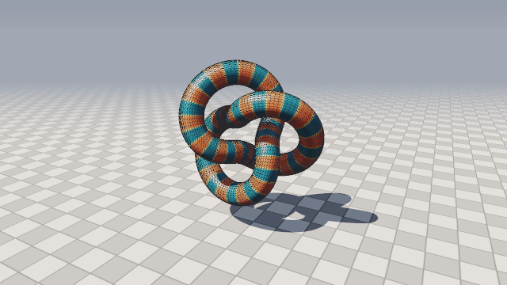 | 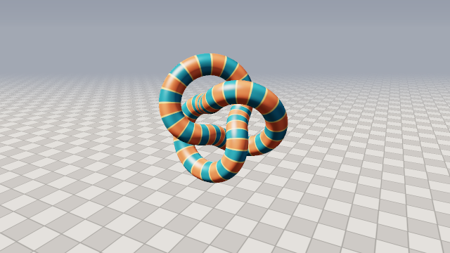 | |

## Texture filtering

The floor seen from a low angle, zoomed 2×, with no supersampling:

| Filter | Result |
|---|---|
| **Bilinear** (level 0 only): grout lines alias into jagged noise | 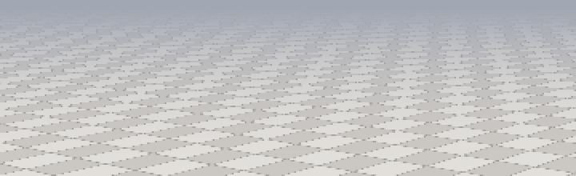 |
| **Trilinear** (mipmapped): no aliasing, but blurry at grazing angles | 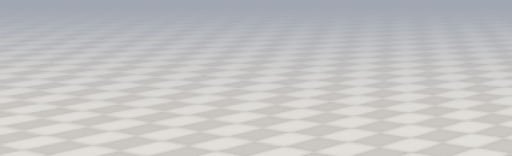 |
| **Anisotropic 8×** (default): clean and sharp | 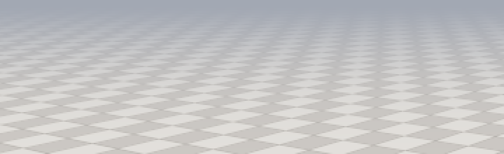 |

The `mips` view colors each pixel by the mip level the derivatives select. Blue is full resolution, and the colors shift toward red and magenta as the texture gets smaller on screen:

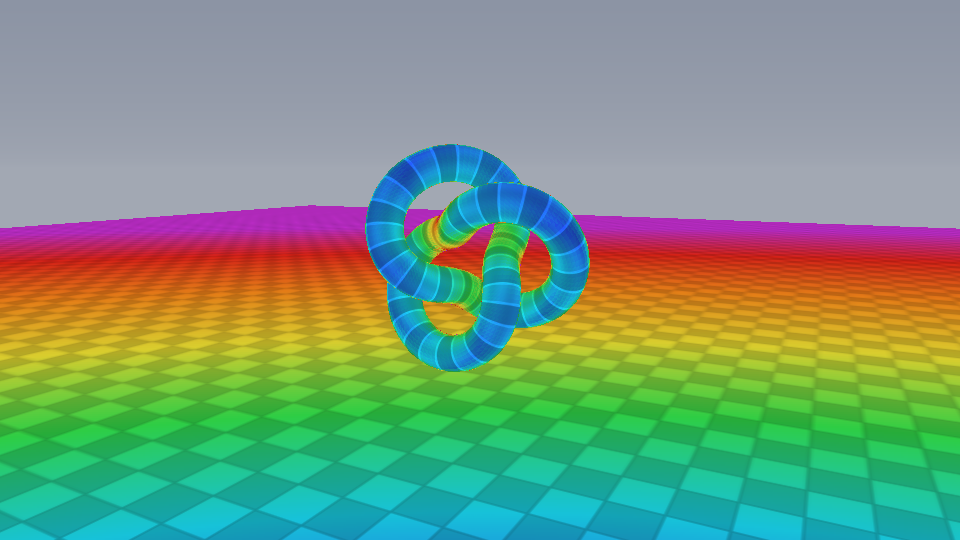

## How a frame is drawn

```
vertex shader ─▶ primitive assembly ─▶ clip (near/far + guard band) ─▶ perspective divide
      ─▶ viewport + backface cull ─▶ edge setup + binning into 8-row bands
      ─▶ 8×8 tile classification ─▶ fixed-point edge functions (top-left rule) in 2×2 quads
      ─▶ early depth test ─▶ perspective-correct varyings + derivatives ─▶ fragment shader
      ─▶ sRGB framebuffer
```

Each frame runs three passes:
1. **Shadow pass:** depth only, rendered from the light into a 2048² shadow map.
2. **Main pass:** sky, then the ground and the model, drawn with the shader for the current view mode.
3. **Overlay (optional):** wireframe of the model's front faces, drawn as lines that are depth-tested against the main pass.

The whole pipeline lives in [`include/sr/rasterizer.hpp`](include/sr/rasterizer.hpp), about 420 lines. A shader looks like this:

```cpp
struct NormalShader {
    struct Varying {                       // anything that supports + and * float
        Vec3 normal;
        Varying operator+(const Varying& o) const { return {normal + o.normal}; }
        Varying operator*(float s) const { return {normal * s}; }
    };
    Mat4 mvp;
    Vec4 vertex(const Vertex& v, Varying& out) const {
        out.normal = v.normal;
        return mvp * Vec4(v.position, 1.0f);           // clip-space position
    }
    bool fragment(const Varying& in, Vec3& color) const {
        color = normalize(in.normal) * 0.5f + Vec3(0.5f);
        return true;                                    // false = discard
    }
};

sr::draw(framebuffer, NormalShader{mvp}, mesh.vertices, mesh.indices);
```

A shader that needs derivatives, for example to choose a mip level, uses a three-argument `fragment` instead. The pipeline detects this at compile time and only interpolates helper lanes for shaders that ask for them:

```cpp
bool fragment(const Varying& in, const sr::Derivatives<Varying>& d, Vec3& color) const {
    color = texture.sample(in.uv, d.ddx.uv, d.ddy.uv, sr::TextureFilter::Anisotropic);
    return true;
}
```

## Building

You need CMake 3.20 or newer and a C++20 compiler. SDL3 is optional and only needed for the viewer.

```bash
# macOS
brew install cmake sdl3
# Ubuntu / Debian (SDL3 is packaged on 25.04+; otherwise only the headless renderer builds)
sudo apt install cmake g++ libsdl3-dev

cmake -S . -B build
cmake --build build -j
ctest --test-dir build        # watertightness, tiles, draw order, derivatives, mipmaps, OBJ, PNG
```

CI builds and tests every push on Linux (GCC and Clang), macOS (Apple Clang, including the SDL3 viewer) and Windows (MSVC). Each job also renders a frame end to end and uploads it as a build artifact.

## Usage

**Interactive viewer:**

```bash
./build/viewer                      # bundled torus knot
./build/viewer path/to/model.obj    # any OBJ: it is recentered, scaled and set on the ground
```

| Input | Action |
|---|---|
| Left drag / wheel | Orbit / zoom |
| Right drag | Move the sun |
| `1` – `5` | Shaded / normals / depth / UV / mip levels |
| `W` `S` `T` | Toggle wireframe / shadows / textures |
| `F` | Cycle texture filter (nearest, bilinear, trilinear, anisotropic) |
| `R` `L` | Toggle model spin / orbiting sun |
| `+` `-` | Change the resolution scale |
| `P` | Save `screenshot.png` |

The window title shows the FPS, render time and triangle count.

**Headless renderer** (renders straight to PNG):

```bash
./build/softrender --out render.png --size 1920x1080 --ssaa 2
./build/softrender --mode normals --wireframe --yaw 60 --pitch 30
./build/softrender --filter trilinear --pitch 8     # compare texture filters
./build/softrender --model bunny.obj --light-yaw 120
./build/softrender --bench 100 --size 1920x1080
```

Run `./build/softrender --help` for all options.

## Performance

These are timings from `softrender --bench 100`: the default scene (a 16,384-triangle knot on a ground plane) with shadows on and the model spinning. Measured on an Apple Silicon Mac with 10 cores in a Release build.

| View | 1280×720 | 1920×1080 |
|---|---|---|
| Debug views (normals) | 1.7 ms (~590 fps) | 3.2 ms (~310 fps) |
| Shaded, bilinear | 7.8 ms (~128 fps) | 14.9 ms (~67 fps) |
| Shaded, trilinear | 8.9 ms (~113 fps) | 18.4 ms (~54 fps) |
| Shaded, anisotropic 8× (default) | 12.9 ms (~77 fps) | 26.0 ms (~38 fps) |

The shadow pass takes about 0.9 ms of each frame. Anisotropic filtering costs the most because floor pixels near the horizon can take up to 8 trilinear taps (16 bilinear lookups). Capping it at 4× saves only about 1 ms with almost no visible difference, so the cap stays at 8×.

### Optimization log

Each change below was profiled with macOS `sample`, verified to produce byte-identical images (except where noted), and timed as the median of three 120-frame runs. Times are for anisotropic shading at 720p.

| Change | Result |
|---|---|
| 8×8 tile classification | **No gain** (16.4 → 16.8 ms). Half of all bounding-box tiles are now skipped, but profiling showed edge tests were never the bottleneck: texture sampling, color conversion and thread stalls were. The tiles stay, since they're the base for future SIMD and hierarchical-Z work. |
| Draw the model before the ground | Small gain at 1080p (32.8 → 31.2 ms). Early-z now rejects floor pixels behind the knot before shading them. |
| Bitmask texture wrapping | **Reverted.** No measurable gain, because Apple Silicon's integer divide is fast. |
| Skip shading on fully fogged pixels | 16.8 → 15.2 ms. These distant horizon pixels were paying for 16 shadow taps and up to 64 texel reads that the fog then hid completely. |
| Display-referred output for debug shaders, sRGB lookup table built at startup | 15.2 → 14.7 ms; debug views 2× faster (4.2 → 2.2 ms). Removed a `powf` round trip per channel and a lazy-init check on every lookup. Debug images change by at most 1/255. |
| Per-band triangle binning with dynamic scheduling | 14.3 → 12.7 ms; debug views 2.2 → 1.7 ms. Each thread used to walk and re-set-up all 16k triangles; now edges are set up once and threads only see the triangles in the band they claimed. |

Overall, measured back to back against the version before this work: anisotropic is 17.3 → 12.9 ms (−25%) at 720p and 34.1 → 26.0 ms (−24%) at 1080p, bilinear is 9.3 → 7.8 ms (−15%), and debug views are 4.6 → 1.7 ms (2.7× faster).

## Project layout

```
include/sr/
  math.hpp          vectors, matrices, projection / look-at
  rasterizer.hpp    the pipeline: clipping, setup, band binning, 8×8 tiles, 2×2 quads, threading
  framebuffer.hpp   color + depth targets, sRGB encode/decode, SSAA downsample
  scene.hpp         camera, render settings, multi-pass renderer
  mesh.hpp          vertex/mesh types, OBJ I/O, procedural geometry
  texture.hpp       mip chains; nearest / bilinear / trilinear / anisotropic sampling
  png.hpp           dependency-free PNG writer
src/                implementations (shaders live in scene.cpp)
apps/               viewer (SDL3) and softrender (headless CLI)
tools/mkassets.cpp  regenerates assets/torus_knot.obj
tests/              rasterizer and file-format tests
```

## Ideas for next steps

- SIMD (NEON/AVX) for edge evaluation and interpolation across a quad's four lanes
- Hierarchical Z: store each tile's farthest depth and skip whole tiles hidden behind earlier geometry
- A persistent thread pool instead of spawning threads per pass
- Normal mapping (tangent-space) and loading textures from files
- A clipping test for triangles that cross the near plane

## License

MIT
